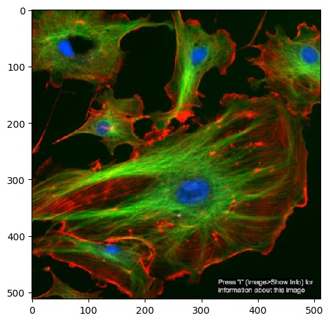
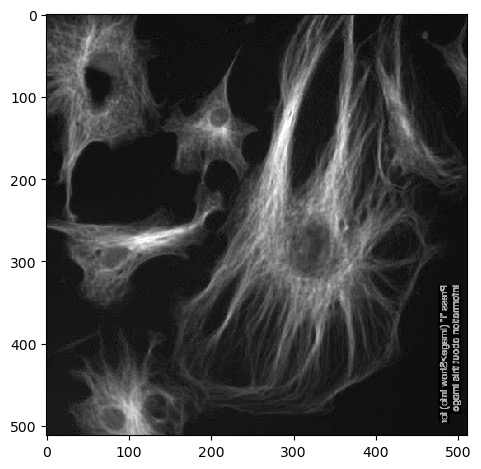
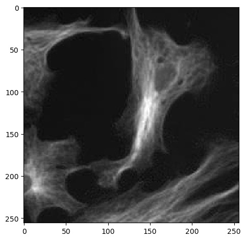
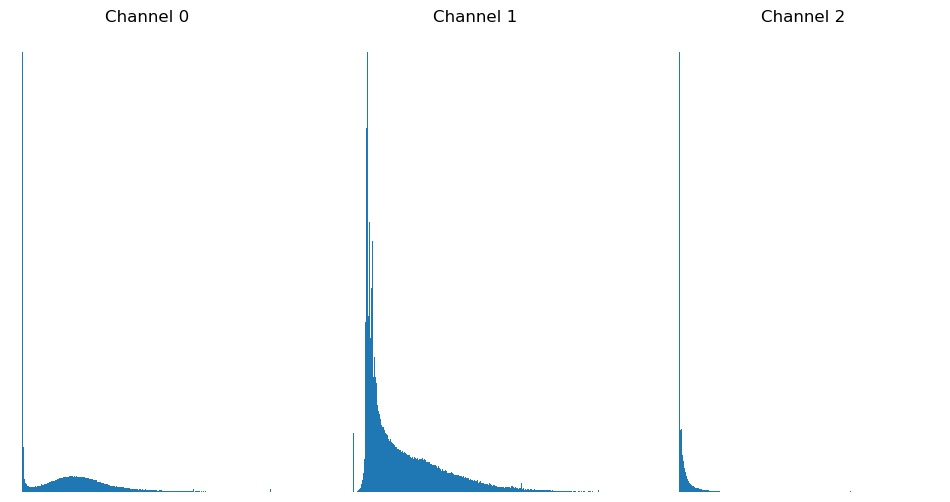
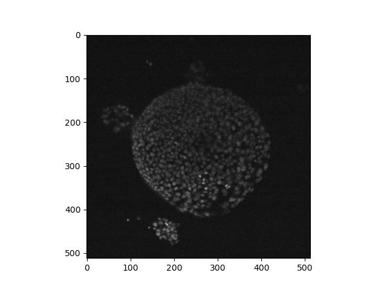
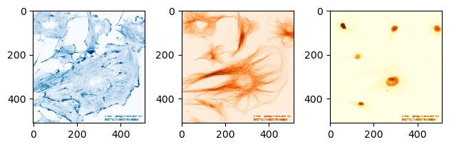

:::::::::::::::::::::::::::::::::::::: questions 
- How do I open an image file in Python for processing?
- How can I explore an image once it's open?
::::::::::::::::::::::::::::::::::::::::::::::::

::::::::::::::::::::::::::::::::::::: objectives
- Open an image with skimage
- Discuss how to open proprietary image formats
- Display an opened image to the screen
::::::::::::::::::::::::::::::::::::::::::::::::

## Opening an image

At its core, an image is a multidimensional array of numbers, and as such can be opened
by programs and libraries designed for working with this kind of data. For Python, one
such library is scikit-image. This library provides a function called `imread` that we
can use to load an image into memory. In a new notebook cell:

```python
from skimage.io import imread
image = imread('data/FluorescentCells_3channel.tif')
```

If you saved your images to a different location, you will need to change the file path
provided to imread accordingly. Paths will be relative to the location of your .ipynb
notebook file.

To view things in Python, usually we use `print()`. However if we try to print this
image to the Jupyter console, instead of the image we get something that may be
unexpected:

```output
> print(image)
array([[[ 16,  50,   0],
        [ 15,  44,   0],
        [ 18,  40,   1],
        ...,
        [  1,  15,   2],
        [  1,  15,   2],
        [  1,  15,   2]]], dtype=uint8)
```

Python has loaded and stored the image as a Numpy `array` object of numbers, and
`print()` displays the string representation or textual form of the data passed
to it, which is why we get a matrix of numbers printed to the screen.

If we want to see what the image looks like, we need tell Python to display it
as an image. We can do this with the `imshow` function from matplotlib, which you
may already be familiar with as a library for drawing plots and graphs, but it can
also display images.

```python
import matplotlib.pyplot as plt

plt.set_cmap('gray')  # by default, single-channel images will now be displayed in greyscale
plt.imshow(image)
```

You should now see the image displayed below the current cell:

{alt='Displaying an image with imshow'}

Since images are multi-dimensional arrays of numbers, we can apply statistical functions
to them and extract some basic metrics. Numpy arrays have methods for several of these
already, including the image's shape, data type and minimum/maximum values:

```python
print(image.shape, image.dtype, image.min(), image.max())
# returns: (512, 512, 3) uint8 0 255
```

This shows that the image has a data type of uint8, it contains values between
0 and 255 and that it is in three dimensions. We can reasonably infer that the two `512` numbers
are the X and Y axes. The third axis in most cases will represent a number of channels.

We can select a single channel by **indexing** the array:

```python
plt.imshow(image[:, :, 2])
```

Here, we select the entire X and Y axes using `:` with no numbers around them, and
the last channel (remember that Python counts from 0).


## Channels, series and stacks

Images can consist of more than two axes. The first two axes are usually X and Y, but if there
is a third axis, then this could be one of several things:

- **Channel** - the image shows different features in the same 2D space. One common example is
  cell images with different staining for nuclei and membranes, expressed as different colours.
- **Time series** - the image is a collection of 2D frames taken at different points in time.
- **Z-stack** - essentially a series of 2D images piled up on top of each other in 3D space.

It's usually easy enough to tell that you're looking at a colour channel from looking at the
image directly, but it may be more difficult to to distinguish a Z or a timepoint axis from
the data alone. If you don't know exactly how the images were generated, it's a good idea to
consult documentation or metadata.

::::::::::::::::::::::::::::::::::::: challenge
## Exercise 1: Loading an image

Load the test image 'FluorescentCells_3channel.tif':

- Try the same as the example above, but display one of the other channels
- Save your single channel to a variable. What happens if you run `imshow` on
  `channel.T`?
- How can we select part of the image, i.e. crop it? Remember that to do this,
  we need to select a subset of the X and/or Y axes.

:::::::::::::::::::::::: solution
Other channels can be loaded with `image[:, :, x]`, where `image` is the variable
the image is saved to and `x` is the index of a channel to retrieve.

Next we can use `.T` to return a **transposed** version of the image. Running
`imshow()` on this results in an image that is flipped 90°:

```python
channel = image[:, :, 1]
plt.imshow(channel.T)
```

{alt='Transposed image'}

Remember that Numpy arrays can be sliced and indexed the same way as lists, strings and
tuples. Up to this point we've been using `:` to select an entire axis, but we can
give it start and end bounds to select part of the X and Y axes, like:

```python
image[:256, 128:384, 1]
```

{alt='2-dimensional slice'}
:::::::::::::::::::::::::::::::::
::::::::::::::::::::::::::::::::::::::::::::::::


Numpy arrays have many more methods available for checking them. Here are just a few to
start with:

### Pixel value statistics

- [`image.mean()`](https://numpy.org/doc/stable/reference/generated/numpy.ndarray.mean.html)
- [`image.min()`](https://numpy.org/doc/stable/reference/generated/numpy.ndarray.min.html)
- [`image.max()`](https://numpy.org/doc/stable/reference/generated/numpy.ndarray.max.html)
- [`image.std()`](https://numpy.org/doc/stable/reference/generated/numpy.ndarray.std.html)

### Image size

[`image.shape`](https://numpy.org/doc/stable/reference/generated/numpy.ndarray.shape.html)

### Object size

[`image.nbytes`](https://numpy.org/doc/stable/reference/generated/numpy.ndarray.nbytes.html)

Note that some of these are functions and need to be called with brackets(`()`), whereas others are
simply attributes that do not.

::::::::::::::::::::::::::::::::::::: challenge
## Exercise 2: Memory check

How much memory did it take to load FluorescentCells_3channel.tif?

:::::::::::::::::::::::: solution
Running `image.nbytes` shows that it takes up 786432 bytes, or ~786 kilobytes, or ~0.7 megabytes.
:::::::::::::::::::::::::::::::::
::::::::::::::::::::::::::::::::::::::::::::::::


## Histograms

Another useful metric in image analysis is an image's histogram. This can be plotted by flattening
the image and passing it to matplotlib:

```python
plt.hist(image[:, :, 0].flatten(), bins=256)
```

First, we need to select a single channel - since different channels may represent different cell organelles
or points in time, we need to ensure that we are comparing like with like. We also need `flatten()` because
we don't care about the arrangement of the pixels, we just want to sort their values values into bins. Finally,
we can use `bins` to control how many bins the data is split into.

::::::::::::::::::::::::::::::::::::: challenge
## Exercise 3: Histograms

Matplotlib has functionality for displaying multiple images or plots side by side in a figure:

```python
# figure size in inches
width = 12
height = 6

# grid-like arrangement of images
rows = 1
columns = 2

# tell matplotlib how big we want tht efigure to be
plt.figure(figsize=(width, height))

# first image
plt.subplot(rows, columns, 1)
plt.imshow(image_1)
plt.title('Image 1')

# second image
plt.subplot(rows, columns, 2)
plt.imshow(image_2)
plt.title('Image 2')
```

Using the above as a reference, plot histograms of the three channels in FluorescentCells_3channel.tif.

Hints:
  - Instead of calling imshow() to display an existing image, you'll need to create a histogram with hist()
  - Python likes to count from 0, e.g. when selecting channels, but note that the index given to subplot() counts
    from 1 - you'll need to account for this

:::::::::::::::::::::::: solution

```python
width = 12
height = 6
rows = 1
columns = 3
plt.figure(figsize=(width, height))

plt.subplot(rows, columns, 1)
plt.hist(image[:, :, 0], bins=255)
plt.title('Channel 0')

plt.subplot(rows, columns, 2)
plt.hist(image[:, :, 1], bins=255)
plt.title('Channel 1')

plt.subplot(rows, columns, 3)
plt.hist(image[:, :, 2], bins=255)
plt.title('Channel 2')

```
{alt='All image channels'}

This example calls subplot() hist() and title() three times each, but of course it would be possible to do this
in a `for` loop.
:::::::::::::::::::::::::::::::::
::::::::::::::::::::::::::::::::::::::::::::::::


## Proprietary formats

Modern microscopes save files in vendor-specific formats (like .czi, .nd2, or .lif). While skimage can handle standard TIF(F)s, these complex files contain vital metadata, for example, pixel spacing information, that we need for accurate analysis.


### The Universal Adapter: BIOIO

Instead of installing a different library for every microscope brand, we recommend BIOIO. It acts as a consistent interface for almost any biological image format, allowing you to use the same commands regardless of the file source.

If using JupyterHub or JupyterLab, go to 'New' -> 'Terminal'. This will open
a shell session in a new browser tab, where you can run `pip install` commands.

::: callout
### Advanced: Scaling up with Dask
Once you are a bit more established as a Python user, the integration of BIOIO with Dask becomes a major advantage. It allows for "Lazy Loading," where the computer only reads the specific pixels you ask for. This is essential for analyzing massive datasets that are larger than your computer's RAM.
:::

:::: challenge
## Exercise 4: Reading with BIOIO

Load the bioio package and use it to read the test file 'data/Ersi_organoid_WT2.nd2'. 

1. Use print(img.dims) to check the dimensions. What does each letter represent?
2. Use get_image_data to extract a single 2D frame for the first channel (C=0) at the middle Z-slice (Z=13).

::: solution
```python
from bioio import BioImage

# Load the image object
img = BioImage('data/Ersi_organoid_WT2.nd2')

# Check dimensions explicitly
print(img.dims)
# Returns: Dimensions [T: 1, C: 3, Z: 27, Y: 512, X: 512]

# Grab a specific slice (Channel 0, Z-slice 13)
pixel_data = img.get_image_data("YX", C=0, Z=13)

import matplotlib.pyplot as plt
plt.imshow(pixel_data)

```

{alt='ND2 image'}

:::::::::::::::::::::::::::::::::
::::::::::::::::::::::::::::::::::::::::::::::::

## Altering the lookup table

Now that we have extracted a specific 2D slice of data using BIOIO, we can explore different ways to display it. 

The imshow() function can take an argument called cmap, which applies a "Lookup Table" (LUT). This maps the numerical intensity values in your image to specific colors on your screen.

```python
# Using the pixel_data we extracted from the BIOIO object earlier
plt.imshow(pixel_data, cmap='viridis')
```

Skimage uses lookup tables from the plotting library matplotlib. A list of available tables
can be obtained with:

```python
from matplotlib import colormaps
print(sorted(colormaps))
```

::::::::::::::::::::::::::::::::::::: challenge
## Exercise 5: Lookup tables

Go back to the FluorescentCells_3channel.tif image. Display each of its three channels side
by side in a matplotlib figure, each in a different colour using `cmap=`. Use the values in
`matplotlib.colormaps` to select a lookup table for each one.

:::::::::::::::::::::::: solution
There will be many ways to do this (and many colour maps to choose from!), but here
is one possible solution:

```python
# you'll need to run this again if you overwrote your `image` variable
image = imread('data/FluorescentCells_3channel.tif')
plt.figure(figsize=(12, 6))

plt.subplot(1, 3, 1)
plt.imshow(image[:, :, 0], cmap='Blues')

plt.subplot(1, 3, 2)
plt.imshow(image[:, :, 1], cmap='Oranges')

plt.subplot(1, 3, 3)
plt.imshow(image[:, :, 2], cmap='YlOrBr')
```

{alt='ND2 image'}

:::::::::::::::::::::::::::::::::

Load hela-cells_rgb.tif and try displaying it with different lookup tables. What results do
you get? Why might this be the case?

:::::::::::::::::::::::: solution
The resulting image will not look as expected, and in Jupyter the image will appear unchanged.
In this case, since the lookup table is being ignored, this would imply that the pixel values
do not represent light intensities but rather are explicitly encoded colour values - i.e. it's
an RGB image.
:::::::::::::::::::::::::::::::::
::::::::::::::::::::::::::::::::::::::::::::::::

## Other notes

### Rearranging channels

In the nd2 example above, the x and y axes are at the end rather than the start. You may find
yourself in a situation where the arrangement of dimensions in your image
is incorrect for the processing you wish to perform on it - maybe a function requires
that an image be oriented in a particular way. This is where it's useful to be able
to rearrange the dimensions of an image. To do this, we can use Numpy's `moveaxis`
function:

```python
import numpy
image = imread('data/FluorescentCells_3channel.tif')
print(image.shape)
# returns: (800, 800, 3)
rearranged_image = numpy.moveaxis(image, -1, 0)
print(rearranged_image.shape)
# returns: (3, 800, 800)
print(image.shape)
# returns: (800, 800, 3)
```

We can see that calling `moveaxis` on an array gives us a rearranged version of the
array given to it - the channel axis that was at the end is now at the front. However,
we can see that the original value of the image is unchanged. This is because by default,
`moveaxis` returns a rearranged **copy** of the image.

The arguments supplied are:

- The image or array
- The current position of the dimension to move
- The position to move that dimension to

In this case, we are moving the dimension at position -1 (i.e. the one at the end) to
position 0 (the start).

### Pixel size

To make real-world measurements, we need the image's pixel size. While older methods required digging through complex metadata dictionaries, BIOIO makes this simple:
```python
# Access the physical pixel sizes directly from the bioio object
print(img.physical_pixel_sizes)
# Returns physical sizes (e.g., X=0.1, Y=0.1, Z=0.5) usually in micrometres.
```

::::::::::::::::::::::::::::::::::::: keypoints
Standard image formats (TIFF, PNG) can be loaded as NumPy arrays using skimage.
Proprietary microscope formats are best handled by BIOIO to preserve dimensions and metadata.
Basic metrics like histograms, shape, and pixel ranges help determine the best analysis strategy.
Lookup tables (LUTs) change how data is rendered visually but do not change the underlying pixel values.
Lazy loading (via Dask in BIOIO) allows you to explore massive datasets without overwhelming your computer's memory.
::::::::::::::::::::::::::::::::::::::::::::::::
